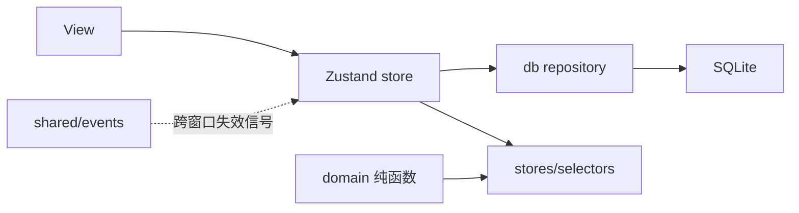

# 架构

> 类型：解释
> 状态：稳定
> 适用版本：v0.1.9+
> 相关：reference/data-model.md、reference/domain-functions.md、reference/windows-and-tray.md

本文解释为什么这样分层。具体表结构、函数签名查 `reference/`。

---

## 1. 技术栈

| 层 | 选型 | 说明 |
|---|---|---|
| 外壳 | Tauri 2 | 双窗口、透明、置顶、开机自启、托盘、更新器 |
| 前端 | React 19 + TypeScript + Vite | 主窗与挂件共用组件和色板 |
| 样式 | Tailwind CSS 4 + CSS 变量 | 设计 token 集中在 `src/ui/tokens.css`，不引 UI 组件库 |
| 状态 | Zustand 5 | 数据缓存与 UI 状态分离；每个窗口独立实例 |
| 存储 | SQLite（`tauri-plugin-sql` / sqlx） | 迁移、唯一约束、索引由数据库兜底 |
| 更新 | `tauri-plugin-updater` + GitHub Releases | 签名不可关闭，端点见 `how-to/release.md` |
| 日期 | date-fns 4 | 业务日期统一 `YYYY-MM-DD` 字符串 |
| 测试 | Vitest 3 + jsdom | domain 纯函数优先；关键 UI 交互有组件测试 |

## 2. 目录结构

```text
DailyTask/
├─ src-tauri/
│  ├─ src/lib.rs                     # 插件、迁移、托盘、窗口事件
│  ├─ migrations/001_init.sql        # 建表 + 索引（历史）
│  ├─ migrations/002_checkin_value.sql
│  ├─ migrations/003_task_interval_every_days.sql
│  ├─ migrations/004_drop_recorded_status.sql
│  └─ tauri.conf.json                # 双窗口尺寸/透明/置顶
├─ src/
│  ├─ main.tsx  App.tsx
│  ├─ app/                           # init、跨窗口同步、托盘进度/文案、更新检查
│  ├─ shared/                        # events、i18n、deleteConfirmation、queue
│  ├─ domain/                        # 纯 TS：types、date、applicability、settle、stats
│  ├─ db/                            # client、tasks、checkins、todos、settings、backup、transfer
│  ├─ stores/                        # 5 个 Zustand store + selectors
│  ├─ windows/main/                  # 主窗与 6 个视图
│  ├─ windows/widget/                # 挂件与胶囊
│  └─ ui/                            # tokens、DateField、CheckCell、ProgressRing、ConfirmDeleteButton
├─ docs/                             # 文档地图见 docs/README.md
├─ design/                           # 设计稿，不进构建
└─ scripts/release.mjs               # 发版脚本
```

## 3. 分层与数据流



- **写**：view → store action → `db/*` → 成功后更新内存 → emit `*Changed`。
- **读**：启动时一次性加载 tasks / checkins / todos / settings；派生值现算不落库。
- **派生**：今日进度、格子投影、streak 由 `domain/*` + `stores/selectors/*` 计算。
- **启动顺序**：`app/init.ts` 串行加载 settings → tasks → checkins → todos，全部就绪前不渲染业务视图。
- **跨窗口**：主窗与挂件使用同一套前端；挂件作为常驻桌面入口保留，主窗关闭时销毁较大的主 WebView，数据从 SQLite 重新加载。
- **权限边界**：只有 `db/*` 允许出现 SQL；`domain/*` 不 import Tauri / React / db。

## 4. store 划分

| store | 持有 | 允许依赖 |
|---|---|---|
| `useTasksStore` | tasks + intervals、CRUD | `db/tasks`、domain |
| `useCheckinsStore` | 打卡 Map，键 `taskId\|date` | `db/checkins` |
| `useTodosStore` | todos、CRUD | `db/todos` |
| `useSettingsStore` | settings（主题、语言、gridZoom、dayStartHour 等） | `db/settings` |
| `useUiStore` | 当前视图、筛选、选中格、挂件展开态 | 无 |

三条硬约束：

1. store 之间禁止互相 import；跨领域派生放 `stores/selectors/*`。
2. `gridZoom` 归 settings，不归 uiStore（持久化配置）。
3. 打卡只存一份 `Map<"taskId|date", Checkin>`，行列视图由 selector 现建。

## 5. 依赖护栏

ESLint `import/no-restricted-paths` 按目录划 zone：

```js
{ target: "./src/domain",  from: "./src", except: ["./domain"] }
{ target: "./src/ui",      from: "./src", except: ["./ui", "./shared", "./domain/types"] }
{ target: "./src/db",      from: "./src", except: ["./db", "./domain", "./shared"] }
{ target: "./src/stores",  from: "./src", except: ["./stores", "./db", "./domain", "./shared"] }
{ target: "./src/windows", from: "./src", except: ["./windows", "./stores", "./domain", "./ui", "./shared"] }
```

额外规则：

- `src/windows/**` 禁止直接 import `db/*`
- `shared/events` 是唯一允许 import `@tauri-apps/api/event` 的文件
- `@tauri-apps/plugin-sql` 只允许 `db/*` 使用
- view 禁止 import `shared/deleteConfirmation`，删除令牌只能由 `ui/ConfirmDeleteButton` 构造

## 6. Code review 清单

1. 新派生值落在 `domain/` 或 `stores/selectors/`，不塞进 store action？
2. store 之间没有互相 import？
3. 没有裸写 `new Date()` 当「今天」，一律走 `logicalToday`？
4. `domain/**` 没有 import React / Tauri / db？
5. 事件名取自 `Events` 常量，payload 有类型？
6. view 没有绕过 store 直接调 `db/*`？
7. 写库成功后 emit 了对应 `*Changed`？
8. 停用/启用任务走「追加区间」，没有改历史区间？
9. 颜色 / 间距 / 圆角取 `tokens.css`，没有裸写色值？
10. 删除入口是否走 `ConfirmDeleteButton`？
